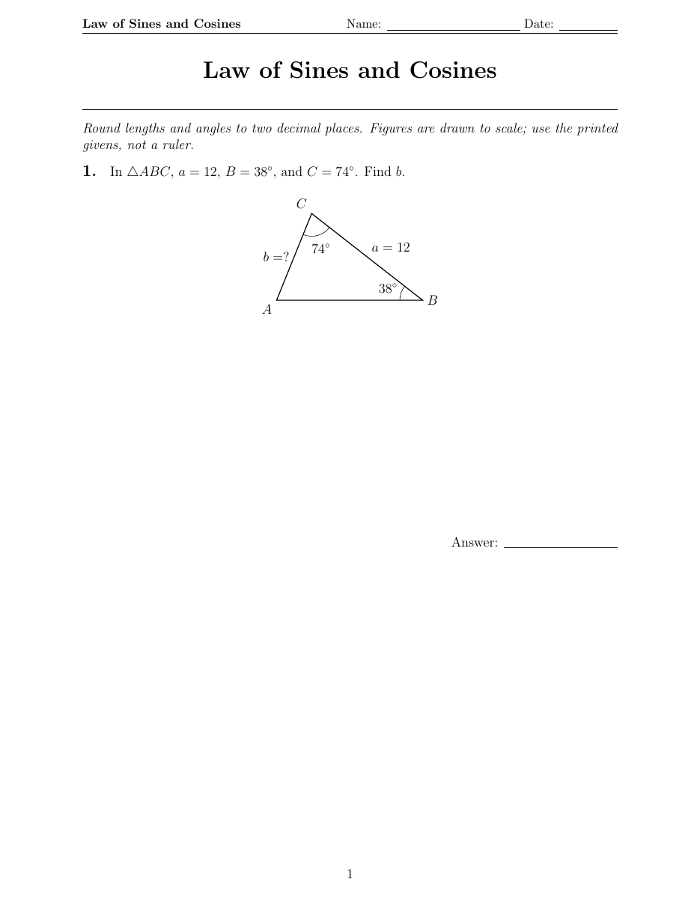
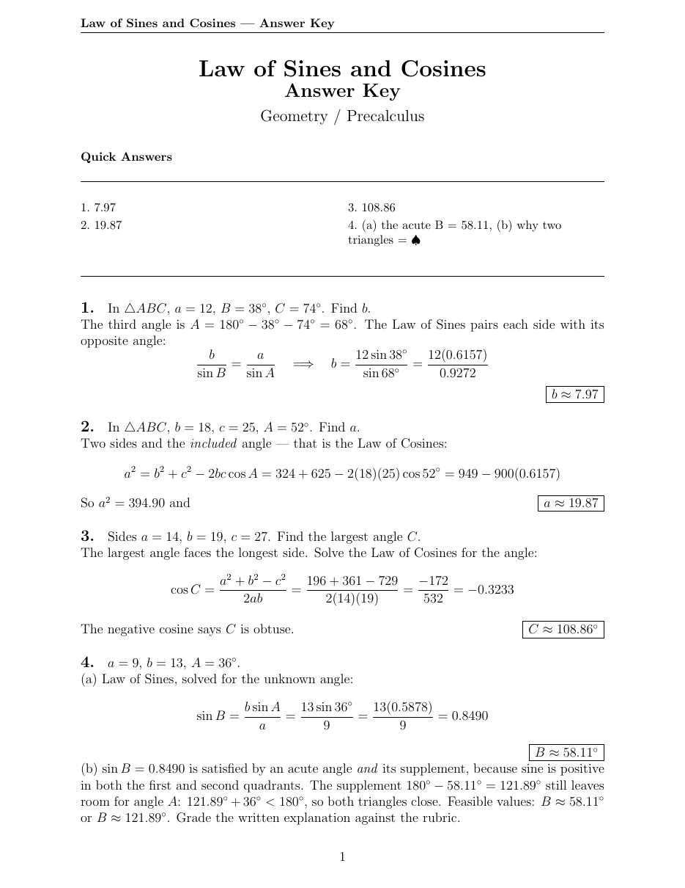
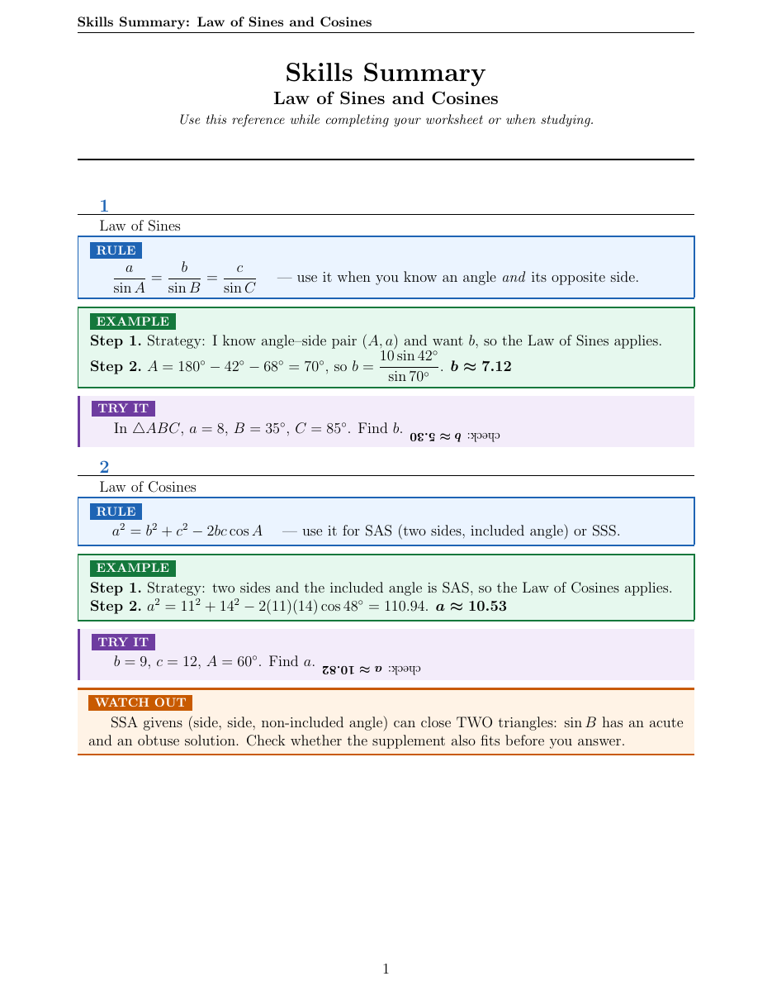
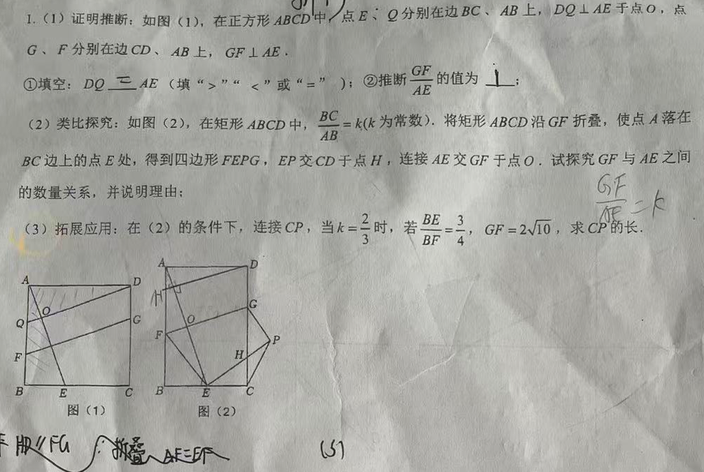
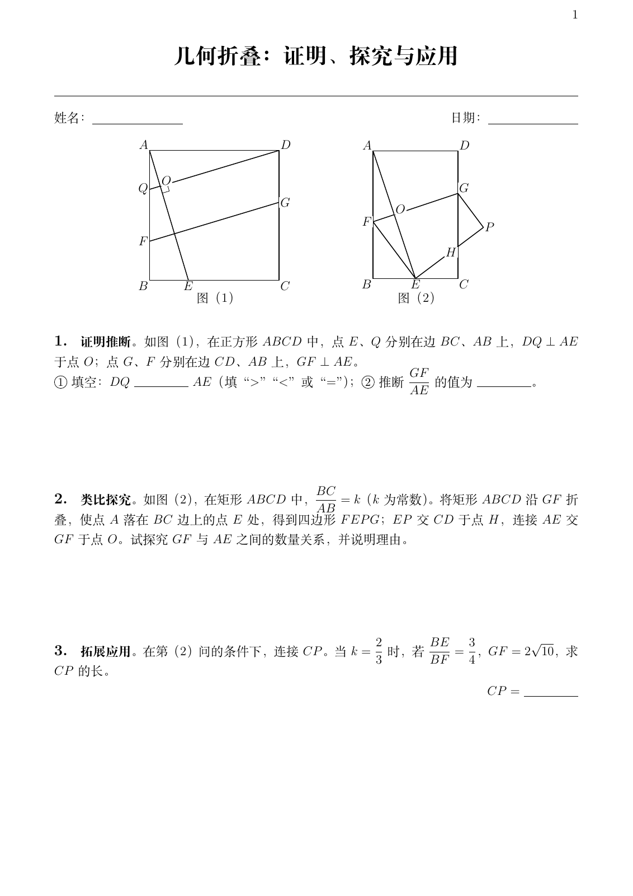
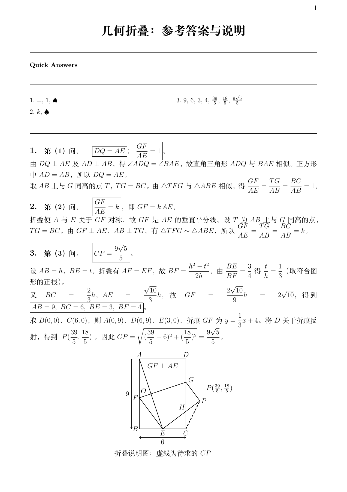
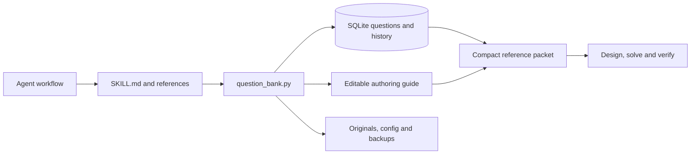
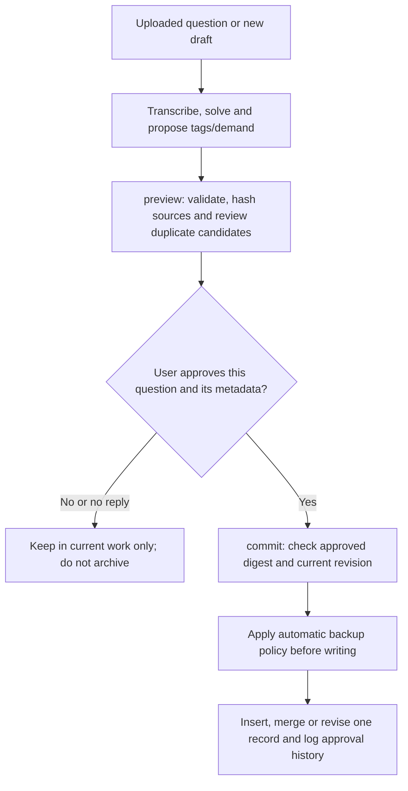

<a id="readme-top"></a>

<div align="center">

<h1>Math Worksheets Skill</h1>
<p><strong>Math practice, faithful reproduction and reusable authoring guidance for your AI agent</strong></p>

<p>
  <a href="https://github.com/Tommie-P-xl/math-worksheets-skill/actions/workflows/tests.yml"></a>
  <a href="https://github.com/Tommie-P-xl/math-worksheets-skill/releases/latest"></a>
  <a href="LICENSE"></a>
</p>

<p><a href="README.zh-CN.md">简体中文</a> &nbsp;|&nbsp; <a href="README.md">English</a></p>
<p><a href="#quick-start">Quick start</a> &nbsp;·&nbsp; <a href="#output-previews">Output previews</a> &nbsp;·&nbsp; <a href="#global-question-bank">Global bank</a> &nbsp;·&nbsp; <a href="#prompt-templates">Prompt templates</a></p>

</div>


Ask your AI agent for math practice, or give it existing questions as text,
screenshots or photos. Get printable PDFs, independently checked answers and
mathematical diagrams drawn with code. Supports elementary math through AP
Calculus BC, using the model and tools your agent already has.

An optional global question bank supplies reusable examples and authoring guidance.
Archival is off by default: each question and guide update needs separate user
review and approval. See [the bank workflow](references/question-bank.md).

| New practice | Faithful reproduction | Global reference bank |
|:---|:---|:---|
| Design within taught scope, solve independently, and deliver questions, keys and optional guides. | Review photos and handwriting, preserve original givens, and redraw mathematical figures with code. | Reuse approved examples and authoring guidance across projects; archival is off by default. |


<details>
<summary>Contents</summary>

- [Quick start](#quick-start)
- [Output previews](#output-previews)
- [Install](#install)
- [Prompt templates](#prompt-templates)
- [How it works](#how-it-works)
- [Global question bank](#global-question-bank)
- [Version and builds](#version-and-builds)
- [Attribution](#attribution)

</details>


---

<a id="quick-start"></a>

## Quick start

| 1 · Install the skill | 2 · Prepare the runtime | 3 · Ask your agent |
|---|---|---|
| Download `math-worksheets-v*.zip` from [Releases](https://github.com/Tommie-P-xl/math-worksheets-skill/releases/latest), then install with CC Switch or manually. | Bank management needs only Python; PDF output additionally needs Bash, SymPy, LaTeX and Poppler. See [full dependencies](#runtime-dependencies). | Specify taught scope, count, language and deliverables, or upload questions for faithful reproduction. |

```text
Use math-worksheets to create 4 NEW questions similar to the uploaded example.
Confirm the grade and taught methods; match its assessment structure and demand.
Deliver an A4 worksheet and detailed key, with questions and answers on separate pages.
Ask before saving each question or guide update; do not archive without my approval.
```

> **Choose the mode first:** use new practice for style references, and reproduction
> to preserve supplied wording and numbers. Calculation checks are not automatic
> proofs of every explanation or figure; see [How it works](#how-it-works).


---

## Output previews

### Function 1: generate practice questions

| Worksheet | Answer key | Study guide |
|:---:|:---:|:---:|
| [](docs/samples/upstream/worksheet_geometry-1.png) | [](docs/samples/upstream/answerkey_geometry-1.png) | [](docs/samples/upstream/skills_summary-1.png) |
| Mathematical figures and printable questions | Quick answers and worked solutions | Rules, examples and try-it problems |

These previews illustrate the worksheet, answer key and study-guide formats.
Their attribution is recorded below. Also see a [data-handling worksheet](docs/samples/upstream/worksheet_data-1.png)
and [answer-key summary page](docs/samples/upstream/answerkey_summary_page.png).
The preview set illustrates a layout with writing room; the current default is
compact, as demonstrated in Function 2. Request writing space explicitly when needed.

### Function 2: reproduce supplied questions

| Uploaded source | Clean student worksheet | Answer key with explanation diagram |
|:---:|:---:|:---:|
| [](docs/examples/photo-folding/source.png) | [](docs/examples/photo-folding/ws_photo_folding.pdf) | [](docs/examples/photo-folding/ak_photo_folding.pdf) |
| Preserve the photo as evidence | Exclude handwritten working; redraw both figures | Independent calculation; add answer-only explanations |

This fork's actual test preserves the three original geometry parts and rebuilds
the diagrams with TikZ. It produces a one-page worksheet and a two-page key;
the key preview shows the solution page, with the verification summary on page two. The application answer
is `CP = 9√5/5`. Ten CAS checks pass; two geometric reasoning entries remain
explicitly marked for manual review. See the
[transcription, prompt and reproducible checks](docs/examples/photo-folding/README.md),
[worksheet PDF](docs/examples/photo-folding/ws_photo_folding.pdf) and
[complete answer-key PDF](docs/examples/photo-folding/ak_photo_folding.pdf).

<p align="right"><a href="#readme-top">Back to top</a></p>


---

## Install

### CC Switch: install the release ZIP

1. Open [Releases](https://github.com/Tommie-P-xl/math-worksheets-skill/releases/latest)
   and download the asset named **`math-worksheets-v*.zip`**.
2. In **CC Switch → Skills → Install from ZIP**, select the downloaded ZIP.
3. Enable/sync the skill for Claude Code, Codex or your chosen agent.
4. Install the runtime dependencies below. If the skill does not appear, restart
   the agent, or point it directly at the installed `SKILL.md`.

The ZIP contains one `math-worksheets/` directory with the skill, scripts,
templates, references and license. README images, example PDFs, tests and release
tools stay outside the installable package. SHA-256 files are attached to releases.
See [CC Switch's Skills guide](https://github.com/farion1231/cc-switch/blob/main/docs/user-manual/zh/3-extensions/3.3-skills.md).

### Manual installation

Extract the same ZIP, then place its **`math-worksheets` folder** in your agent's
skill location:

| Agent | Personal skill directory |
|---|---|
| Claude Code | `~/.claude/skills/math-worksheets/` |
| Codex | `~/.agents/skills/math-worksheets/` |
| Other agents | Use their skill directory, or explicitly reference `SKILL.md` |

Codex users can explicitly mention `$math-worksheets`; other agents can use the
plain-language prompts below. See the [official skill documentation](https://learn.chatgpt.com/docs/build-skills).
To inspect/develop the fork, clone it anywhere:

```bash
git clone --depth 1 https://github.com/Tommie-P-xl/math-worksheets-skill.git
```

Then ask: `Follow /absolute/path/math-worksheets-skill/SKILL.md to make my worksheet.`

### Runtime dependencies

| Tool | Purpose |
|---|---|
| Bash | Run the build chain; on Windows, Git Bash or MSYS2 |
| Python + SymPy ≥1.12 | Answer checking; recommend the measured upstream version 1.14.0 |
| Tectonic or pdflatex | Compile ordinary LaTeX documents; pgfplots ≥1.18 required |
| XeLaTeX + CJK fonts | Chinese/Unicode examples; ctex and Fandol fonts are used here |
| Poppler `pdftotext` | Check text positions in the compiled PDFs |

```bash
python -m pip install "sympy==1.14.0"
```

Use [Tectonic](https://github.com/tectonic-typesetting/tectonic/releases) or an
installed TeX distribution. On Debian/Ubuntu, Chinese examples need
`texlive-xetex` and `texlive-lang-chinese`; Poppler tools are in `poppler-utils`.
On Windows, run the scripts in Bash with Python, TeX and `pdftotext` on its PATH.
If multiple Pythons are installed, set `MWS_PYTHON` to the interpreter that has
SymPy. `MWS_LATEX_ENGINE=xelatex` explicitly selects the Chinese-capable engine;
auto mode detects ctex/xeCJK/fontspec documents.

<p align="right"><a href="#readme-top">Back to top</a></p>


---

## Prompt templates

Question layout is compact by default, without reserved writing space between stems.
Original fill-in blanks remain. Ask explicitly for writing room when desired.
Geometry labels use transparent backgrounds and are placed clear of lines.

### General request

```text
Use math-worksheets.
Mode: [new practice / reproduce supplied questions / study guide only]
Input/topic: [topic, pasted question text, or attached screenshots/photos]
Level and quantity: [for new practice; do not add questions in reproduction mode]
Language/paper: [English/Chinese/etc.; A4/Letter]
Deliver: [worksheet + concise key + guide / worksheet + key / worksheet only]
Figures: redraw mathematical figures programmatically; ask about complex photos.
Answers: solve independently, verify supported responses, keep explanations concise.
Output directory: [your chosen folder]
```

### Function 1 prompt templates: generate practice questions

| Scenario | Copyable prompt |
|---|---|
| Law of sines/cosines | `Use math-worksheets to make Leo 8 law-of-sines/cosines problems, with a figure for each, a worked key and a study guide.` |
| Elementary multiplication | `Make Lucy, a third grader, a 12-problem times-tables worksheet, with an answer key and study guide.` |
| Factoring | `Make 15 factoring-trinomial problems for an eighth grader, ramping the difficulty, with concise worked solutions.` |
| Data handling | `Make 8 problems reading a bar chart and calculating mean, median, mode and range. Include the chart, verified answers and a guide.` |
| Calculus | `Make 10 AP Calculus chain-rule problems with a worked key and a short derivative-rules guide.` |
| Tiered equations | `Make support/core/challenge systems-of-equations worksheets aligned to 8.EE.C.8. Verify each tier separately and include its key.` |
| New practice from a style reference | `Use this homework photo as a style/difficulty reference, then create 10 NEW graphing-polynomial problems with matching grids and worked answers.` |

The style-reference case creates **new questions**. To typeset the original
questions themselves, choose reproduction below.

### Function 2 prompt templates: reproduce and explain supplied questions


<details>
<summary>Text input</summary>

**Text input**

```text
Use math-worksheets to turn the question text below into an A4 PDF.
Keep the original wording, values, options and order; do not create extra questions.
Redraw functions/geometry where needed. Solve independently and deliver a concise key.
[Paste the questions here]
```

</details>

<details>
<summary>Screenshot/photo with handwriting — the real example above</summary>

**Screenshot/photo with handwriting — the real example above**

```text
Use math-worksheets to reproduce the attached geometry photo as a Chinese A4 worksheet.
Keep all three parts, labels, conditions and their order. Exclude handwritten answers.
Ask about any important symbol/label obscured by handwriting rather than guessing.
Redraw both mathematical figures with code. Independently solve and verify the answers.
Deliver the worksheet and a concise key, with an explanation diagram for the last part.
No study guide is needed. Save everything in my chosen output directory.
```

</details>

<details>
<summary>Student PDF only</summary>

**Student PDF only**

```text
Reproduce these supplied questions using math-worksheets. Deliver only the blank
student worksheet; solve/check the answers internally. Exclude handwritten working
and do not add answer-only auxiliary lines to the student figures.
```

</details>

<details>
<summary>Complex photo/illustration</summary>

**Complex photo/illustration**

```text
Typeset this train/photo-based question. Redraw mathematical diagrams with code.
For the complex image, first offer a clean crop, then supported image generation,
then a programmatic schematic preserving all solving information. Let me choose.
Do not invent labels or reconstruct unreadable givens from an imagined answer.
```

</details>

<details>
<summary>Graphical explanation or guide only</summary>

**Graphical explanation or guide only**

```text
Make a concise verified answer key for these supplied function/geometry questions.
Whenever a solution adds auxiliary lines, intersections or reflected points,
include the resulting labeled diagram in that answer. Use LaTeX fraction commands
for every mathematical quotient in answers, including intermediate steps and
coordinates; do not print slash fractions. Keep solution-only information out of
the student PDF.
```

```text
Make only a two-page study guide for [topic], with rules, worked examples and try-it
questions. Verify the computed results; do not generate a separate worksheet.
```

</details>


<p align="right"><a href="#readme-top">Back to top</a></p>


---

## How it works

The agent designs or transcribes questions, independently solves them, and writes
LaTeX plus verification JSON. The build checks answer data, answer slots, units,
source consistency and writing space, compiles the PDFs, then checks text collisions.
Reproduction additionally binds reviewed transcription and external-image records.

| Mode | Default documents |
|---|---|
| New practice | Worksheet + key + guide |
| Existing questions | Worksheet + key; guide optional |
| Worksheet only | Student PDF; answers still checked internally |
| Guide only | Guide PDF with checked examples |

Proofs, explanations, OCR fidelity and external-image content require review.
The CAS gate verifies supported mathematics, not every sentence of a proof or
every pixel of a figure. A clear review record is not a machine proof.

<p align="right"><a href="#readme-top">Back to top</a></p>


---

## Global question bank

The bank helps an agent decide what kinds of similar questions to write and how
to control their demand. It stores reusable material outside the project and
skill directories. It uses Python's standard library and SQLite; it needs no
database server, extra model subscription, embedding service or background process.
The existing PDF and mathematical verification dependencies still apply when
producing worksheets.

### Architecture and responsibilities



<details>
<summary>Expand: directory layout and detailed data flow</summary>

```text
Installed skill                         Global user data home
SKILL.md + references                   bank.sqlite
    │ workflow and consent rules           ├─ problems: text/JSON content and revision
    ▼                                      ├─ tags: indexed many-to-one labels
scripts/question_bank.py ────────────────►  ├─ guides: identity, hash and provenance
    │ validation, retrieval, storage       └─ events: approved before/after history
    │                                   guides/STAGE/SUBJECT.md
    │                                      └─ current, directly editable authoring guide
    │                                   sources/<content-hash>.<extension>
    │                                      └─ approved originals, deduplicated by content
    │                                   config.json + backups/
    ▼
Compact reference packet → question design → independent solution → existing checks/PDF build
```

</details>


| Component | What it stores or enforces |
|---|---|
| `problems` | One stable ID and unique content fingerprint per question; stem, answer, solution, demand profile, diagram description, sources and revision are text/JSON. Grades and answers do not create a second question identity. |
| `tags` | Searchable labels linked to the question ID. Each category has at most **5 labels per question**; an item can carry both grade and exam labels without being copied. This is not a five-label limit on the entire bank. |
| `guides` | A unique `(stage, subject)` key, deterministic file path, content hash, revision and research provenance. Stages are **小学 / 初中 / 高中** (primary / lower secondary / upper secondary). |
| `guides/STAGE/SUBJECT.md` | The authoritative current guide text, e.g. `guides/初中/数学.md`. Topic sections live inside that one file. Direct user edits are read immediately; SQL metadata/history does not replace the file. |
| `events` | Approval note/digest and before/after records for approved writes. This is revision history, not an inbox for unapproved uploads. |
| `sources/` | Original files copied only after approval. A page/question locator distinguishes separate questions on the same scan. Source hashes detect changed or corrupt originals. |

Text storage keeps mathematics inspectable: formulas use LaTeX, and diagrams may
store semantic givens plus TikZ/pgfplots/SVG code. Layout coordinates and
answer-only overlays remain distinct from question givens. The bank never executes
stored drawing code. SQLite itself is a binary file; the CLI returns compact JSON
instead of asking the agent to read the database file.

### Question intake and approval



The agent asks about **each uploaded question**, showing proposed stage, grade or
exam, knowledge and type labels. Users can correct those details or decline.
Generated questions and guide changes need their own approval; approval of one
does not approve the others. A pending archival decision does not block otherwise
authorized question generation.

`preview` creates no persistent pending record and copies no source files. Its
SHA-256 receipt binds the proposal, source bytes and current target revision.
`commit` requires that receipt and an approval note. A changed proposal or stale
revision is rejected. The receipt prevents accidental stale writes; **the agent
must still obtain a real user reply** rather than fabricate the note.

Exact content matches, or the same source occurrence, target one existing record;
approved grade/exam tags and source references merge into it. Conflicting answers
require an explicit revision. Text-similar candidates require review; this is a
heuristic, not a proof of mathematical equivalence. Label unions over five are
rejected so the user can approve a concise replacement. Nothing is silently cut.

### Retrieval and authoring flow

1. Confirm the taught scope. Extract **knowledge span, estimated key reasoning
   steps, method visibility, calculation load, case-analysis burden, scaffolding,
   and difficulty with its basis**. Estimates stay separate from observed student
   outcomes; a cognitive-demand label is not a calibrated success rate.
2. Run `context` with stage/subject and relevant grade/topic filters. SQLite's tag
   index applies the metadata filters; text matching ranks the resulting examples.
   Guide sections are selected by relevance. The packet defaults to **5 references**,
   with a hard maximum of **10 questions and documents combined** and a default
   **10000-character output budget**. This is a character budget, not an exact token
   count. Truncated fields are marked; full solutions/code are fetched only when needed.
3. Reuse suitable local material. If the references are missing or inadequate, use
   the agent's available web tools for a short official curriculum/assessment lookup.
   An unrelated general guide does not suppress the need for research. Without web
   access, state the unverified scope assumption. The CLI does not browse by itself.
4. Plan the target skill, question family, decisive inference, subpart progression,
   scoring points and difficulty levers. Solve before finalizing the wording; check
   admissible cases, taught methods and whether the intended optimum is attainable.
   Use the existing `verify.py` and build gates for supported calculations and PDFs.
5. Offer any new example or research summary for optional saving. A guide proposal
   records source URLs, checked dates and applicable scope. Reuse an applicable local
   summary next time; recheck time-sensitive requirements when the requested year or
   scope changes. User approval is required before retaining or replacing it.

The agent tracks the ten-reference limit across the whole authoring request,
including follow-up reads, not just each CLI invocation. Examples and guidance
improve the available context; this is not automatic model training or a guarantee
of educational quality. Supported calculations, geometric proofs, source fidelity
and classroom suitability still require their respective checks.

### Location, configuration and reinstallation

Home resolution is identical in every project: **`--home` → `MWS_DATA_HOME` → OS
default**. Read-only use of a missing bank returns empty without creating a folder.

| OS | Default data home |
|---|---|
| Windows | `%LOCALAPPDATA%\MathWorksheets` (usually `C:\Users\<user>\AppData\Local\MathWorksheets`) |
| macOS | `~/Library/Application Support/MathWorksheets` |
| Linux | `${XDG_DATA_HOME:-~/.local/share}/math-worksheets` |

The database is `bank.sqlite` inside that home. Run `stats` to see the **actual
resolved path**: packaged or redirected Windows environments may map AppData to
another physical location. No machine-specific path or personal database is
distributed in this repository or the installable ZIP.

**Deleting and reinstalling only the skill does not delete its database, originals,
guides or backups.** Reinstallation reconnects to the same data home. If the account,
environment or configured home changes, point `MWS_DATA_HOME` to the existing home
or restore a backup; a newly empty path does not mean the old data was deleted.
Removing the data directory or clearing the host application's data is a separate
operation and is not covered by the skill-only reinstallation guarantee.

<details>
<summary>Expand: fixed locations, migration and length configuration</summary>

For a fixed cross-project location, set the same `MWS_DATA_HOME` in the environments
that run the agent. The following PowerShell example assumes `D:\MathWorksheetsData`
is already your data home (or you intend to start a new bank there):

```powershell
$env:MWS_DATA_HOME = 'D:\MathWorksheetsData'
```

Setting the variable changes path selection; it **does not move existing data**.
To migrate, back up the old home, restore to an absent/empty destination, verify it,
then update the variable in each relevant environment. A session variable is not a
permanent system setting. Other devices/cloud agents need an explicit transfer or
a separate synchronization design.

`config.json` defaults to:

```json
{"guide_max_chars":6000,"backup_keep":7}
```

Each stage-subject guide is capped at **6000 Unicode characters**, including headings
and links; the configurable range is 500–12000. Both proposed writes and direct-edit
reads enforce the cap. Overlength content produces an error with its path, rather
than truncation or an extra topic-specific guide. Edit the guide or adjust the cap.

</details>

### Maintenance and backup

You can ask the agent to inspect storage, open the authoring guide, export text or
create a backup. For direct use, replace `PATH_TO_SKILL` with the installed path:

```powershell
python PATH_TO_SKILL/scripts/question_bank.py stats
python PATH_TO_SKILL/scripts/question_bank.py doctor
python PATH_TO_SKILL/scripts/question_bank.py context --stage 初中 --subject 数学 --topic 相似三角形 --limit 5
python PATH_TO_SKILL/scripts/question_bank.py guide-show --stage 初中 --subject 数学
python PATH_TO_SKILL/scripts/question_bank.py export --out D:/Exports/math-bank.jsonl
python PATH_TO_SKILL/scripts/question_bank.py backup --out D:/Backups/math-bank.zip
python PATH_TO_SKILL/scripts/question_bank.py restore --file D:/Backups/math-bank.zip --home D:/MathBank-Restored
```

| Operation | Implementation and scope |
|---|---|
| `stats` | Resolved home, question/guide counts, top five labels per category, total distinct label counts, and separate database/original/guide/backup sizes. |
| `doctor` | SQLite integrity and foreign keys, question fingerprints, tag indexes, missing/corrupt originals, and missing/overlength/user-edited guides. |
| `export` | JSONL text records for questions and current guides; original file bytes are not included. Import questions individually through review/approval. |
| `backup` | SQLite backup API snapshot plus current guide files, original files, config and a SHA-256 manifest in one ZIP. |
| `restore` | Verify manifest, file hashes and restored data in a staging directory; install only into an absent/empty destination, preserving an existing bank. |

Before the first applicable write on a new day, an existing populated bank gets an
automatic snapshot; the default retention is seven tool-owned `auto-*.zip` files.
Manual backups are not pruned by this policy. Keep an additional backup copy on a
different disk for disk-loss recovery. Schema versions are checked; incompatible
versions are refused rather than initialized over existing data.

See [the detailed workflow and JSON schema](references/question-bank.md) and the
entry points in [question_bank.py](scripts/question_bank.py). Behavioral checks in
[test_question_bank.py](tests/test_question_bank.py) use synthetic questions and
isolated data homes, covering default refusal, bound approvals, deduplication,
limits, direct guide edits, reinstallation paths and backup/restore.

<p align="right"><a href="#readme-top">Back to top</a></p>


---

## Version and builds

The current version is maintained only in `metadata.version` in
[`SKILL.md`](SKILL.md). [`tools/version.py`](tools/version.py) is the shared reader
for packaging and publishing; it derives ZIP names, tag validation and release-note
headings. The README badge reads GitHub Releases directly. Historical changelog
entries and Python/SymPy dependency versions are not current-version configuration.

| Artifact | Where to get it |
|---|---|
| Installable package and checksum | The [latest release](https://github.com/Tommie-P-xl/math-worksheets-skill/releases/latest) contains `math-worksheets-v*.zip` and `.zip.sha256`. |
| Source and history | [Repository](https://github.com/Tommie-P-xl/math-worksheets-skill) · [Release notes](RELEASE_NOTES.md) · [Maintainer tools](tools/README.md) |

<details>
<summary>Expand: maintainer build and verification commands</summary>

```bash
python tools/version.py
python tools/version.py --tag
python tools/package_skill.py
python -m unittest discover -s tests -v
```

Build output goes to `dist/`; the ZIP contains only the `math-worksheets/` runtime
directory. The release workflow validates the tag, builds the package and runs
tests before publishing ZIP and SHA-256 assets. Full tests require the PDF runtime
above. Personal banks, originals and backups never enter the release package.

</details>


<p align="right"><a href="#readme-top">Back to top</a></p>


---

## Attribution

Fork of [stellawuellner/math-worksheets-skill](https://github.com/stellawuellner/math-worksheets-skill).
Retains its verifier, templates and mathematical references. Original previews
come from upstream commit `21312be`; the Chinese photograph example was generated
and checked in this fork. [MIT license](LICENSE).

<p align="right"><a href="#readme-top">Back to top</a></p>
