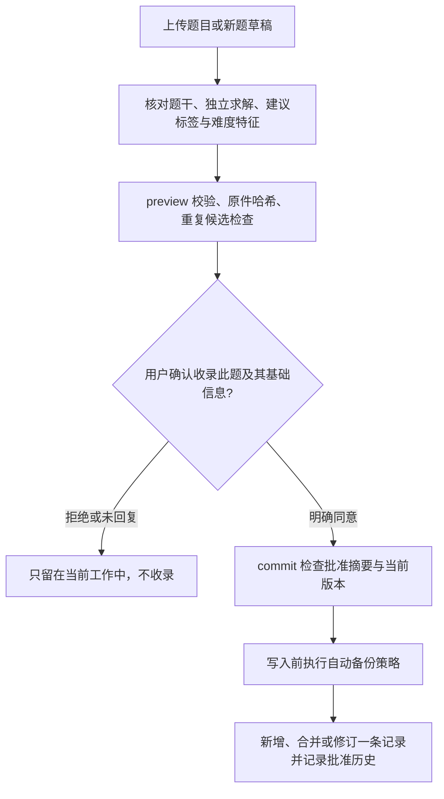

# Math Worksheets Skill

[English](README.md) | 简体中文

[](https://github.com/Tommie-P-xl/math-worksheets-skill/actions/workflows/tests.yml)
[](https://github.com/Tommie-P-xl/math-worksheets-skill/releases/latest)
[](LICENSE)

告诉 AI 你想练什么，或直接提供题目文字、截图、照片，生成可打印的数学练习 PDF。
支持基础算术到 AP 微积分，可独立求解、验算答案，并用程序绘制数学图形。
使用 Agent 已有的模型与工具，不需要专用的出题服务。

可选的全局题库提供参考题目和命题经验。**默认不收藏**：每道题及每次命题文档更新，
都需要用户分别审核、确认后保存。详见[题库使用说明](references/question-bank.md)。

[效果展示](#效果展示) · [全局题库](#全局题库) · [安装](#安装) · [使用模板](#使用模板) · [工作方式](#工作方式)

## 效果展示

### 功能一：生成练习题

| 学生练习册 | 答案册 | 知识点总结 |
|:---:|:---:|:---:|
| [](docs/samples/upstream/worksheet_geometry-1.png) | [](docs/samples/upstream/answerkey_geometry-1.png) | [](docs/samples/upstream/skills_summary-1.png) |
| 数学图形与可打印题目 | 快速答案与解题步骤 | 公式、例题和独立尝试题 |

这组展示练习册、答案册和知识点总结的形式，示例来源见文末。
还可查看[数据处理练习册](docs/samples/upstream/worksheet_data-1.png)
和[答案册总结页](docs/samples/upstream/answerkey_summary_page.png)。
这组预览演示了留答题空间的排版；当前默认采用紧凑型，效果见功能二。
需要留空白作答区域时，请在提示中明确说明。

### 功能二：复现已有题目

| 用户原始照片 | 重排后的学生练习册 | 含说明图的简洁答案册 |
|:---:|:---:|:---:|
| [](docs/examples/photo-folding/source.png) | [](docs/examples/photo-folding/ws_photo_folding.pdf) | [](docs/examples/photo-folding/ak_photo_folding.pdf) |
| 留存原始输入作为核对依据 | 排除手写过程，程序重绘两幅图 | 独立求解，在答案中补充必要图示 |

这组是本 fork **实际生成并检查的结果**：保留原题三问，生成 1 页学生练习册、
2 页答案册；答案预览展示含说明图的解答页，第 2 页为验证摘要。第三问结果为
`CP = 9√5/5`。10 项数学检查通过，2 项几何理由保留人工审核标记。

[下载练习册 PDF](docs/examples/photo-folding/ws_photo_folding.pdf) ·
[下载完整答案册 PDF](docs/examples/photo-folding/ak_photo_folding.pdf) ·
[查看题干核对记录、使用提示与复现方法](docs/examples/photo-folding/README.md)

## 全局题库

题库帮助 Agent 判断“应该出什么类型的题目，以及如何控制难度”。题目与命题经验独立于
项目和 skill 目录存储，跨项目复用。存储工具只用 Python 标准库与 SQLite，无需数据库
服务器、额外模型订阅、向量服务或后台进程。实际生成 PDF 时仍需原有的数学与排版依赖。

### 架构与数据分工

```text
skill 安装目录                         用户全局数据目录
SKILL.md + references                  bank.sqlite
    │ 流程与确认规则                      ├─ problems：题目文本/JSON、版本
    ▼                                     ├─ tags：关联题目 ID 的标签索引
scripts/question_bank.py ──────────────►   ├─ guides：文档标识、哈希、来源
    │ 校验、检索、持久化                  └─ events：已批准修改的前后记录
    │                                  guides/学段/学科.md
    │                                     └─ 当前命题文档，可直接编辑
    │                                  sources/内容哈希.扩展名
    │                                     └─ 批准后保存的原件，按内容去重
    │                                  config.json + backups/
    ▼
精简参考包 → 设计新题 → 独立求解 → 原有数学校验与 PDF 构建
```

| 组成 | 存什么、如何约束 |
|---|---|
| `problems` | 每题一个稳定 ID 和唯一内容指纹；题干、答案、步骤、难度特征、图形描述、来源与版本以文本/JSON 保存。年级、答案不会形成第二份题目身份。 |
| `tags` | 标签关联题目 ID 并建立检索索引。**每道题的每类标签最多 5 个**；同题可兼有多个年级和考试标签。上限针对单题，不是整个题库只能有 5 个知识点。 |
| `guides` | 以 `(学段, 学科)` 为唯一键，保存固定文件路径、内容哈希、版本和调研来源。学段仅允许**小学、初中、高中**。 |
| `guides/学段/学科.md` | 当前命题文档的正文，以文件为准，例如 `guides/初中/数学.md`。知识点作为文档内的小节，用户直接修改后立即读取，不必重新导入。SQL 元数据与历史不会覆盖文件正文。 |
| `events` | 已批准写入的确认说明、摘要及修改前后记录，用于追溯；不用于偷偷保存待确认题目。 |
| `sources/` | 只有批准后才复制原件。页码/题号定位用于区分同一张扫描图中的不同题目，哈希用于原件去重和损坏检测。 |

数学公式使用 LaTeX 文本；图形可保存“数学条件＋TikZ/pgfplots/SVG 代码”，将绘图坐标、
答案专用辅助线与原题已知条件分开。题库工具不会执行保存的绘图代码。SQLite 文件本身
是二进制，但题目内容仍是文本；Agent 通过脚本获取精简 JSON，不读取整个数据库文件。

### 题目收录与确认流程



Agent 必须逐题展示建议的学段、年级/考试、知识点、题型，询问是否收录及信息是否准确。
用户可修改或拒绝。生成的新题、命题文档更新都需分别确认，不能用“同意这一题”代替
其他项目的批准。入库确认尚未完成，不影响已经授权的正常出题。

`preview` 不写全局待办记录、不复制原件，生成的 SHA-256 摘要绑定当前草稿、原件字节和
目标记录版本。`commit` 需要该摘要与用户确认说明，草稿变化或版本过期会被拒绝。
摘要防止意外提交过期内容；**Agent 仍必须取得真实的用户回复，不能自行编造批准说明。**

内容完全匹配或来源中的同一题会指向已有记录，批准后的年级/考试标签及来源合并到该题。
答案冲突需要明确修订。相近文本作为候选交给用户判断，不能宣称已自动证明两题数学等价。
合并后标签超过 5 个会报错，须提出准确的概括标签供用户确认，不会静默删减。

### 检索参考与出题流程

1. 先确认实际教学范围，提取**知识跨度、关键推理步数估计、方法隐蔽程度、计算量、
   分类讨论负担、提示程度、难度判断及依据**。预估与学生实际作答结果分开，认知层级
   标签不能直接当成校准后的得分率。
2. 用 `context` 指定学段、学科及相关年级/知识点。SQLite 标签索引先筛选，再以文本匹配
   排序题目，并选择相关命题文档段落。默认 **5 项参考**，题目与文档合计最多 **10 项**；
   默认输出预算 **10000 字符**，不等于精确 token 数。截短字段会明确标记，需要时再
   读取已选题目的完整解答或图形代码。
3. 已有适用参考就直接复用；缺少或内容不足时，借助 Agent 可用的联网工具简查官方
   课程/命题资料。无关的通用文档不会被当成主题资料充分。没有联网能力时说明尚未核定的
   范围假设。脚本本身不自动联网。
4. 制定简短命题计划：考查点、题型结构、关键推理、小问衔接、评分点和难度调整方式。
   先求解再完善题面，检查所有分支、已学方法、最值是否能在允许位置取得，再接入原有
   `verify.py` 与 PDF 构建检查。
5. 如需留存新题或研究总结，再提交可审核的草稿。命题文档记录来源链接、核对日期和
   适用范围；下次适用时直接复用。考试年份或范围变化等时效性要求仍应重新核对。
   保存或替换研究总结之前必须获得用户批准。

Agent 应按整个出题请求累计不同题目/文档数量，后续调用不能重置 10 项上限。
这套机制改善的是参考上下文与命题流程，不会自动训练模型参数，也不保证教育质量。
计算结果、几何证明、原题忠实度与课堂适配仍要分别检查。

### 默认位置、配置与卸载重装

所有项目按同一顺序选择数据目录：**命令行 `--home` → 环境变量 `MWS_DATA_HOME` →
操作系统默认值**。读取不存在的题库会返回空，不创建目录。

| 系统 | 默认数据目录 |
|---|---|
| Windows | `%LOCALAPPDATA%\MathWorksheets`，通常是 `C:\Users\<用户名>\AppData\Local\MathWorksheets` |
| macOS | `~/Library/Application Support/MathWorksheets` |
| Linux | `${XDG_DATA_HOME:-~/.local/share}/math-worksheets` |

数据库文件是该目录中的 `bank.sqlite`。用 `stats` 查看**实际解析后的绝对路径**：
Windows 打包应用或重定向环境可能把 AppData 映射到其他物理位置。仓库与安装 ZIP 不包含
个人题库或某台电脑专用的绝对路径。

**只删除、更新或重新安装 skill，不会删除数据库、原件、命题文档或备份。**重新安装后
继续使用同一数据目录即可读取原数据。如果切换用户、运行环境或自定义路径，应让
`MWS_DATA_HOME` 指向旧目录，或从备份恢复；新目录显示为空不代表旧数据被删除。
删除数据目录、清理宿主应用数据是另一个操作，不属于“仅重装 skill”的保留范围。

若要固定跨项目使用的位置，请在运行 Agent 的各环境中设置相同的 `MWS_DATA_HOME`。
以下 PowerShell 示例假定 `D:\MathWorksheetsData` 已是你的数据目录，或你打算在此新建题库：

```powershell
$env:MWS_DATA_HOME = 'D:\MathWorksheetsData'
```

**设置环境变量只改变路径选择，不自动迁移旧数据。**迁移应先备份旧库，恢复到不存在或
空的新目录，校验后再更新各环境的变量。当前会话变量不是永久系统设置。其他电脑或云端
Agent 还需显式传输数据，或另行设计同步。

`config.json` 默认内容为：

```json
{"guide_max_chars":6000,"backup_keep":7}
```

每个学段学科文档默认最多 **6000 个 Unicode 字符**，包含标题与链接，可调整为
500–12000 字符。提交和直接编辑后的读取都检查上限；超长会提示文件路径，须缩写或调整
配置，不会截掉末尾文字，也不会自动拆成多个知识点文档。

### 查看、维护与备份

可以直接对 Agent 说“查看题库存量和占用”“打开初中数学命题文档”“导出题库”或
“备份题库”。如需直接运行，将 `PATH_TO_SKILL` 替换为安装路径：

```powershell
python PATH_TO_SKILL/scripts/question_bank.py stats
python PATH_TO_SKILL/scripts/question_bank.py doctor
python PATH_TO_SKILL/scripts/question_bank.py context --stage 初中 --subject 数学 --topic 相似三角形 --limit 5
python PATH_TO_SKILL/scripts/question_bank.py guide-show --stage 初中 --subject 数学
python PATH_TO_SKILL/scripts/question_bank.py export --out D:/Exports/math-bank.jsonl
python PATH_TO_SKILL/scripts/question_bank.py backup --out D:/Backups/math-bank.zip
python PATH_TO_SKILL/scripts/question_bank.py restore --file D:/Backups/math-bank.zip --home D:/MathBank-Restored
```

| 操作 | 实现与范围 |
|---|---|
| `stats` | 显示实际目录、题目/文档数、各类前 5 个常见标签、不同标签总数，以及数据库、原件、文档、备份各自占用。 |
| `doctor` | 检查 SQLite 完整性、外键、题目指纹、标签索引、原件缺失/损坏及文档缺失/超长/用户修改情况。 |
| `export` | 导出题目及当前命题文档的 JSONL 文本，不含原件字节；导入题目仍须逐项预览与批准。 |
| `backup` | 用 SQLite 备份 API 生成数据库快照，将命题文档、原件、配置和 SHA-256 校验清单一并写入 ZIP。 |
| `restore` | 在临时目录验证清单、文件哈希和恢复后的数据，只写入不存在或空的目标目录，保留已有题库。 |

已有内容的题库在新一天首次适用写入前生成自动快照，默认保留 7 份工具生成的
`auto-*.zip`；手动备份不受该清理策略影响。可另外保留异盘备份应对磁盘故障。
工具会检查数据库版本，不兼容时拒绝打开，不会覆盖初始化已有数据。

详细操作及 JSON 格式见[题库流程说明](references/question-bank.md)，实现入口为
[question_bank.py](scripts/question_bank.py)。[行为测试](tests/test_question_bank.py)使用
合成题与隔离数据目录，覆盖默认不入库、批准绑定、去重、上限、直接编辑、重装路径和
备份恢复，不会自动收录用户测试时上传的真题。

## 安装

### 方式一：使用 CC Switch 安装 ZIP

1. 打开 [Releases](https://github.com/Tommie-P-xl/math-worksheets-skill/releases/latest)，
   下载名称为 **`math-worksheets-v*.zip`** 的附件。
2. 打开 **CC Switch → Skills → 从 ZIP 安装**，选择下载的 ZIP。
3. 将技能启用或同步到 Claude Code、Codex 等需要使用的 Agent。
4. 按下面的说明准备运行依赖。若 Agent 尚未显示该技能，重启，或直接指定安装目录的 `SKILL.md`。

ZIP 中只有一个 `math-worksheets/` 目录，包含技能入口、脚本、模板、参考资料和许可。
README 图片、示例 PDF、测试和发布工具不进入安装包。每个发布版本附带 SHA-256 校验文件。
操作界面可参考 [CC Switch 技能管理说明](https://github.com/farion1231/cc-switch/blob/main/docs/user-manual/zh/3-extensions/3.3-skills.md)。

### 方式二：手动安装

解压同一个 ZIP，把其中的 **`math-worksheets` 文件夹**放入对应的个人技能目录：

| Agent | 安装位置 |
|---|---|
| Claude Code | `~/.claude/skills/math-worksheets/` |
| Codex | `~/.agents/skills/math-worksheets/` |
| 其他 Agent | 对应的技能目录，或直接在提示中指定 `SKILL.md` |

Codex 可以用 `$math-worksheets` 显式调用；其他 Agent 可直接使用后面的自然语言模板。
Codex 的技能加载方式见[官方说明](https://learn.chatgpt.com/docs/build-skills)。
如果要查看或开发源码，也可以克隆仓库：

```bash
git clone --depth 1 https://github.com/Tommie-P-xl/math-worksheets-skill.git
```

随后告诉 Agent：`请按照 /绝对路径/math-worksheets-skill/SKILL.md 制作练习册。`

### 运行依赖

| 工具 | 用途 |
|---|---|
| Bash | 执行构建流程；Windows 可使用 Git Bash 或 MSYS2 |
| Python + SymPy ≥1.12 | 验算答案；建议使用上游评测基线版本 1.14.0 |
| Tectonic 或 pdflatex | 编译普通 LaTeX 文档，需要 pgfplots ≥1.18 |
| XeLaTeX 与中文字体 | 编译中文示例；本例使用 ctex 与 Fandol 字体 |
| Poppler 的 `pdftotext` | 检查成品 PDF 中的文字位置和重叠 |

```bash
python -m pip install "sympy==1.14.0"
```

LaTeX 可以使用 [Tectonic](https://github.com/tectonic-typesetting/tectonic/releases)
或已有的 TeX 发行版。Debian/Ubuntu 的中文编译依赖包括 `texlive-xetex`、
`texlive-lang-chinese`；PDF 工具由 `poppler-utils` 提供。

Windows 需要在 Bash 中运行脚本，并确保能找到 Python、TeX 和 `pdftotext`。
多个 Python 并存时，用 `MWS_PYTHON` 指定已安装 SymPy 的解释器。
中文文档可设置 `MWS_LATEX_ENGINE=xelatex`；自动模式会识别 ctex/xeCJK/fontspec 源文件。

## 使用模板

题目默认紧凑排列，不在题干之间留答题空间；原题中的填空位置保留。
只有明确要求时才增加作答区域。几何字母采用透明背景，并放在不与线条相交的位置。

### 通用模板

```text
使用 math-worksheets。
模式：[新出练习题 / 复现已有题目 / 仅制作知识点总结]
输入或主题：[知识点、粘贴的题目文字，或附上的截图/照片]
年级和题量：[新出题时填写；复现时保留原题，不增加题目]
语言和纸张：[中文/英文等；A4/Letter]
交付：[练习册+简洁答案+总结 / 练习册+答案 / 仅学生练习册]
图形：数学图形优先用程序重绘，复杂照片先询问处理方案。
答案：独立求解、验算可计算结果，说明精简但保留关键推理。
输出目录：[指定文件夹]
```

### 功能一使用模板：生成练习题

| 场景 | 可直接复制的使用提示 |
|---|---|
| 正弦定理、余弦定理 | `使用 math-worksheets，给 Leo 出 8 道正弦定理和余弦定理练习，每题配图，附分步答案和知识点总结。` |
| 小学乘法 | `给三年级学生 Lucy 制作 12 道乘法表练习，附答案册和知识点总结。` |
| 因式分解 | `给八年级学生出 15 道三项式因式分解题，难度逐渐增加，附简洁分步解答。` |
| 统计与数据读取 | `制作 8 道读取柱状图并计算平均数、中位数、众数和极差的题，附图表、验算答案和复习页。` |
| 微积分 | `制作 10 道 AP 微积分链式法则练习，附分步答案和简短的求导公式总结。` |
| 分层练习 | `围绕 8.EE.C.8 方程组标准制作基础、常规、挑战三个层次的练习册，每层单独验算并附答案。` |
| 参考照片风格另出题 | `把这张作业照片作为风格和难度参考，另外出 10 道新的多项式图像题，使用匹配的坐标网格并附解答。` |

“参考照片风格另出题”会生成**新题**；如果需要保留照片中的原题，请用下面的复现模板。

### 功能二使用模板：复现与解释题目

**将题目文字排成 PDF**

```text
使用 math-worksheets，把下面的题目文字整理成 A4 PDF。
保留原题题干、数值、选项与顺序，不增加题目。
有函数图像或几何图形时优先程序重绘，独立求解并生成简洁答案册。
[在这里粘贴题目]
```

**复现带手写内容的截图/照片：上面的实际示例**

```text
使用 math-worksheets，将附上的几何题照片复现为中文 A4 练习册。
保留原题三问、点名、条件与顺序，不另出题。
区分印刷题干与手写批注，学生版不保留手写答案。
如果重要符号或图形标注被遮挡、无法确认，先问我，不要猜。
两幅数学图形用程序重绘。独立求解并验算，制作简洁答案册。
最后一问增加必要的说明图，不需要知识点总结。
全部文件保存到我指定的输出目录。
```

**只交付学生练习册**

```text
使用 math-worksheets 复现这些已有题目，只交付空白的学生练习 PDF。
答案仍在内部独立求解和验算，但不输出答案册。
去除手写过程，学生图中不添加答案专用的辅助线和计算结果。
```

**题干含火车、照片等复杂插图**

```text
将这道含火车/实景照片的题排成练习册，数学图形用程序重绘。
复杂图片请先提供处理选择：我补充干净截图、可用时借助生图、
用不影响解题的程序示意图，让我选定后再处理。
不要根据猜测的答案补造看不清的标注或已知条件。
```

**需要图形化解释的答案**

```text
为这些函数或几何题制作简洁答案册，独立求解验算。
涉及交点、辅助线、折叠或抽象步骤时，适当用程序加一幅说明图。
文字只保留关键推理，答案专用信息不要出现在学生练习册中。
```

**只制作知识点总结**

```text
围绕[主题]制作两页知识点总结，包含公式、分步例题和独立尝试题。
验算所有计算结果，不额外生成练习册。
```

## 工作方式

Agent 出题或转录题目、独立求解，并写入 LaTeX 与验证 JSON。
构建流程检查数学结果、作答项覆盖、单位、文档一致性和作答空间，
编译 PDF 后再检查文字重叠。复现模式额外绑定题目审核记录与外部图片文件。

| 模式 | 默认输出 |
|---|---|
| 新出题 | 练习册、答案册、知识点总结 |
| 复现已有题目 | 练习册、答案册；总结可选 |
| 仅学生练习册 | 学生 PDF；内部仍验算答案 |
| 仅知识点总结 | 含已验算例题的总结 PDF |

证明、开放解释、OCR 忠实度和外部图片内容仍需要审核。
CAS 通过表示支持的数学计算通过检查，不代表每句证明和所有图形细节都已自动验证；
图片审核记录也不等于机器证明。

## 来源与许可

基于 [stellawuellner/math-worksheets-skill](https://github.com/stellawuellner/math-worksheets-skill)，
保留其数学验证器、模板和参考资料。原有预览来自上游提交 `21312be`；
中文拍照题示例由本 fork 实际生成和检查。使用 [MIT 许可](LICENSE)。
