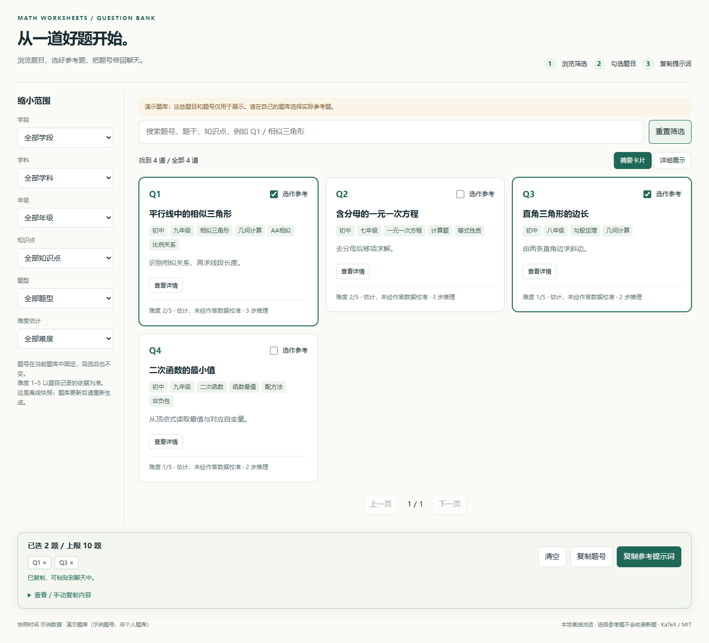
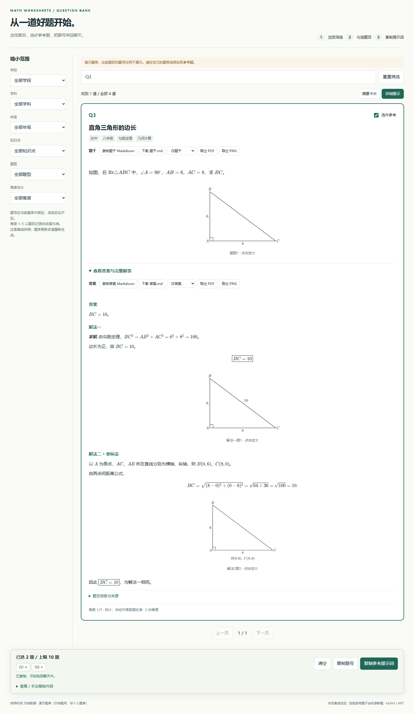

# 从题库选参考题，再让 AI 出同类型题

这是实际运行离线浏览工具得到的示例，使用四道合成题，不读取或展示个人题库。





## 用户操作

1. 安装 ZIP 后，在聊天中说：“打开我的全局题库，让我先选参考题。”
2. AI 运行 `question_bank.py browse --out WORK/bank.html --open`。浏览时只读题库，
   不产生新题收录或迁移，也不需要启动服务。
3. 在摘要卡片中按标题、知识点、题型、方法和难度快速筛选；选择“详细展示”，每行查看一道完整题目。
4. 勾选 `Q1` 与 `Q3`，点击“复制参考提示词”。筛选和分页不会丢失当前选择。
5. 回到聊天，粘贴提示词，并补充：

   ```text
   参考 Q1、Q3，各出 2 道同类型题。
   九年级，已学相似三角形和勾股定理。
   保持推理结构，计算量稍降，中文 A4 题目与答案，暂不收录新题。
   ```

生成的完整提示词还包括题库位置、浏览时的题名与修订号。当前演示页明确标记为
“演示题库”；这些编号不能当作个人题库中的同号题。
浏览页面为中文；中英文聊天均可使用同样的 `Q` 题号。
两种视图都不单列“图形条件”。摘要模式不显示任何题图或答案图；详细模式中可展开
答案、分步解答和辅助图，并点击图片放大。题干、答案和解答均渲染公式和常见 LaTeX 文本结构。
题图与解答图默认按接近纸质试卷的尺寸显示，公式下方不显示横向滚动条。

## 复制给 AI，或导出单题

例如打开 Q3 的详细展示：

1. 点击 **复制题干 Markdown**，得到题干的 `$…$` 公式与 `tikz` 绘图代码块；
   将文本粘贴回聊天：“请解释这道题为什么使用勾股定理”。也可下载 `Q3-stem.md`。
2. 展开答案，点击 **复制答案 Markdown**，得到答案、完整解答和标注斜边长度的
   答案图源码，适合继续讨论解题步骤。该内容不混入题干导出。
3. 在导出范围选择 **题干和答案**，点击 **导出 PDF**，在预览中点击
   **打印 / 保存 PDF**，选择浏览器的“另存为 PDF”。若只需要学生题目，改选 **仅题干**。
4. 同样的范围下点击 **导出 PNG**，直接下载包含渲染公式和图片的高清长图。

Q3 还保存了第二种“坐标法”：HTML、答案 Markdown 及 PDF/PNG 均按解法分别展示
文字、公式和各自的图。一个题号对应一条记录，添加解法不会创建另一道题。
演示中的两种方法都得到 $BC=10$；它们的核心数值关系均可独立核对。

所有操作均可离线完成，导出不包含筛选栏、选题按钮或个人题库路径。

## AI 如何使用这些编号

```text
python SKILL_DIR/scripts/question_bank.py config
python SKILL_DIR/scripts/question_bank.py select Q1 Q3 --fields title,stem,answer,solution,alternative_solutions,tags,demand,diagram,verification
```

如果提示词带了自定义题库位置，追加 `--home BANK_HOME`。`select` 返回对应的完整题干、
解答、难度信息、原内部 ID、短题号和修订号。AI 先核对题名/版本，再把两题的考查模式
用于新题设计，遵守学生已学范围并独立求解。题目与命题指南合计仍遵守参考上限。
找不到题号时明确报告，不自动选择其他题替代。

| 演示题号 | 原题考查 | 用作参考时需要保留的结构 |
| --- | --- | --- |
| Q1 | 平行线中的相似三角形；答案 DE=6 | 识别对应角与相似关系，先得到整边，再用对应边比例 |
| Q2 | 含分母的一元一次方程；答案 x=5 | 去分母、合并同类项、求解并代入核对 |
| Q3 | 已知两条直角边求斜边；答案 BC=10 | 识别直角与斜边，列勾股关系，取正根 |
| Q4 | 从顶点式求二次函数最小值；答案 -1，x=2 | 用平方非负性判断下界并给出等号条件 |

## 下载和复现

- 下载 [browser.html](browser.html) 后可直接双击打开，公式、字体和数据均已内嵌。
- 从仓库根目录运行 `python tools/build_browser_example.py` 可重建该演示页。
  脚本只在临时目录创建合成题库，完成后清理，不接触个人数据。
- 截图在真实 Chromium 浏览器中从生成的 HTML 取得：选择“几何计算”，勾选 Q1、Q3。
- Q1 使用保存的 SVG，Q3 使用保存的 TikZ；后者由导出程序自动渲染并嵌入 HTML。
  Q1 同时包含嵌套小问和答案宏，Q2 演示未加数学分隔符的旧式公式；Q3 的解答另含标注斜边结果的答案图。
  多幅 TikZ/pgfplots 题图也会按保存顺序全部显示，点击任意题图可以放大。
  重建 TikZ 示例需要 XeLaTeX（或 pdfLaTeX）与 Poppler 的 `pdftoppm`；缺少时页面会明确提示。
- 安装包仅包含工具和公式资源，不含此演示页、截图、个人题目或测试数据。

完整功能、短题号规则、TikZ/pgfplots 的显示限制及方案比较见
[浏览工具说明](../../../references/bank-browser.md)。
